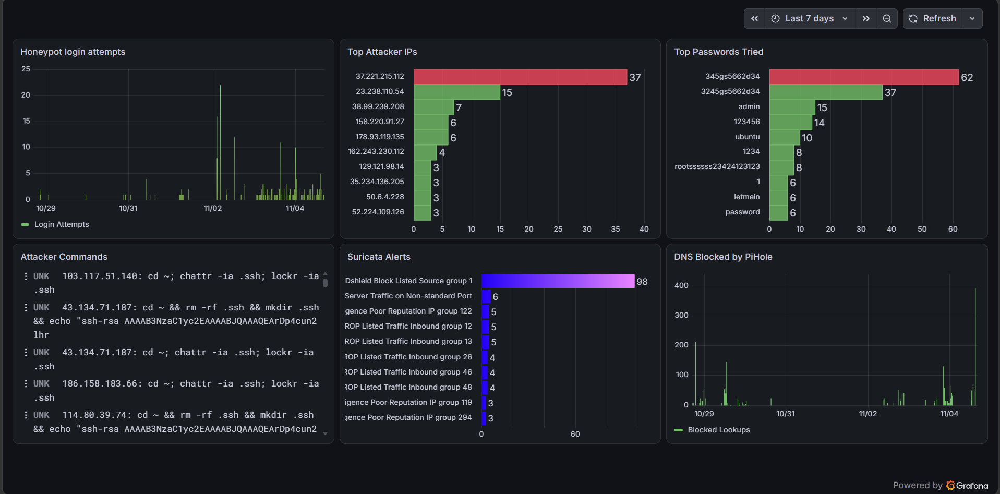
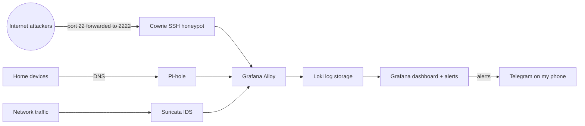
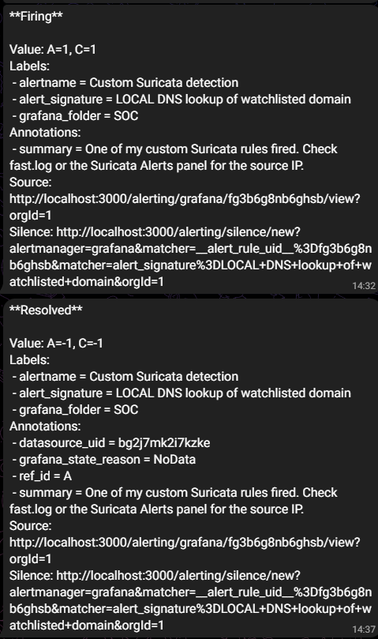

# Home Security Operations Lab (Raspberry Pi 5)

A self-built mini Security Operations Center running on a Raspberry Pi 5 (8GB). It monitors DNS and network traffic, runs an internet-facing SSH honeypot to capture real attacker behavior, centralizes all logs in a SIEM-style dashboard, and sends alerts to my phone.

## Highlights

- **~800 brute-force login attempts from 600+ unique IPs in the first 8 days** of exposing the honeypot
- Captured a botnet's **SSH-key persistence script** (wipes `.ssh`, plants its own key, unlocks files with `chattr`)
- Top attacker: a data-center IP with a **100% AbuseIPDB confidence score** and 100+ reports
- **Custom Suricata rules** and **Grafana alert rules** that page my phone via Telegram — tested end to end
- Observed activity mapped to **MITRE ATT&CK** ([full mapping](docs/mitre-mapping.md))

## Architecture

## Components

| Tool | Role |
| --- | --- |
| **Suricata** | Intrusion detection system — 53,000+ Emerging Threats rules plus my own custom rules |
| **Cowrie** | Medium-interaction SSH honeypot — records credentials, commands, and downloads from real attackers |
| **Pi-hole** | DNS filtering and visibility — blocks ads, trackers, and known-malicious domains |
| **Grafana Alloy** | Collects and ships logs from all three sources |
| **Loki** | Stores and indexes logs |
| **Grafana** | Dashboards and alert rules (SIEM-style) |
| **Docker Compose** | Runs the honeypot and log pipeline as isolated containers |

## Findings

**Top passwords attempted:** `345gs5662d34` and `3245gs5662d34` (passwords widely seen by honeypots from a large SSH botnet), followed by `admin`, `123456`, `ubuntu`, `psql`, and empty passwords — showing why default and weak credentials get compromised.

**Attacks are highly distributed:** 600+ unique IPs averaged only about one attempt each, a sign of botnet activity spread across many infected machines. Blocking individual IPs would not stop this — key-only SSH does.

**Persistence attempts:** multiple unrelated IPs ran the same script to delete existing SSH keys, add the attacker's own public key to `authorized_keys`, and remove immutable file attributes (`chattr -ia .ssh`) — a botnet fighting rivals for control of compromised servers (MITRE T1098.004, T1222.002).

## Detections and Alerting

- **Custom Suricata rules** ([local.rules](suricata/local.rules)): watchlisted-domain DNS lookup (SID 1000001) and SSH brute-force burst against the honeypot (SID 1000002)
- **Grafana alert rules** (checked every minute, delivered to Telegram):
  - Honeypot brute-force burst — one IP making 10+ attempts in 5 minutes
  - Honeypot file download — attacker fetching a file (likely malware)
  - Custom Suricata detection — any of my `LOCAL` rules firing
- **Tuning:** suppressed a noisy, benign Suricata stream alert only for my upstream DNS provider instead of disabling the rule ([tuning log](docs/tuning-log.md))

## Security Hardening

- Key-only SSH; password and root login disabled
- Default-deny firewall (UFW), management access limited to the home network
- Docker containers run with dropped capabilities and `no-new-privileges`; logs mounted read-only
- Log database never exposed; dashboard bound to the LAN only
- Automatic security updates; nightly IDS rule updates
- Secrets kept out of the repository (`.env` + `.gitignore`)

## Lessons Learned

- **Test your own hardening.** My SSH password-login setting was silently overridden by `50-cloud-init.conf`, because SSH applies the first value it reads alphabetically. I caught it by testing from another machine and fixed it with load order.
- **Docker bypasses host firewalls.** Published container ports skip UFW, so I avoided publishing the log database and bound the dashboard to the LAN.
- **IPv6 changes exposure.** Unlike IPv4 behind NAT, the Pi received its own public IPv6 address, which made the firewall essential.
- **Secrets leak easily.** I exposed a bot token in a screenshot and rotated it immediately; I also learned honeypots record any password typed into them, including your own.
## Repository Layout

- `docker-compose.yml` — Cowrie, Loki, Alloy, and Grafana containers
- `alloy/config.alloy` — log collection config
- `suricata/local.rules` — my custom detection rules
- `suricata/threshold.config` — alert tuning (suppressions)
- `docs/tuning-log.md` — tuning decisions and reasoning
- `docs/mitre-mapping.md` — MITRE ATT&CK mapping
- `docs/screenshots/` — dashboard and alert screenshots

## Known Limitations

- Suricata sees traffic to and from the Pi itself (including all honeypot traffic), not every device on the network — full visibility would need a switch with port mirroring
- Suricata's `HOME_NET` covers IPv4 only
- Pi-hole protects only devices manually pointed at it (my ISP's router doesn't allow changing network-wide DNS)
